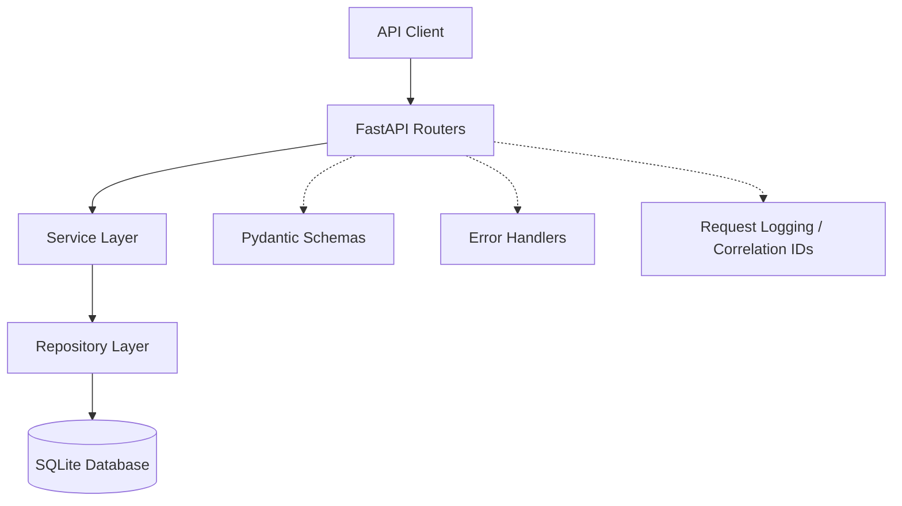

# Week 3 — Complaint API Architecture

## Overview

The Banking Complaint Resolution Assistant uses a layered FastAPI architecture to separate HTTP request handling, business logic, and database operations.

## Architecture Diagram

## Component Responsibilities

| Component | Responsibility |
|---|---|
| FastAPI Routers | Handle HTTP requests and return API responses |
| Pydantic Schemas | Validate incoming request data |
| Service Layer | Apply business rules and complaint status transitions |
| Repository Layer | Perform database operations using SQLAlchemy |
| SQLite Database | Store complaints, customers, accounts and status-history events |
| Error Handlers | Generate standardized API error responses |
| Logging Middleware | Record request outcomes, processing time and correlation IDs |

## Main API Resources

- Complaints: create, retrieve and update complaint status.
- Customers: retrieve customer information and associated complaints.
- Accounts: retrieve account information.
- Events: access complaint status-history events.
- Health: application liveness and readiness checks.

## Transaction Handling

Complaint creation and status-history insertion are performed within the service and persistence layers.

The integration tests verify that a failed status-history insertion does not leave a newly created complaint persisted in the database.

## Testing Strategy

- Unit tests validate business logic independently.
- Integration tests validate HTTP behavior and database persistence.
- End-to-end tests validate complete complaint lifecycle scenarios using a temporary SQLite database.

## Known Limitations

Authentication and authorization controls are not currently enforced by the API. This security finding must be addressed or explicitly accepted before deployment with real customer data.

The Week 3 API provides the baseline for the Week 4 RAG integration.
