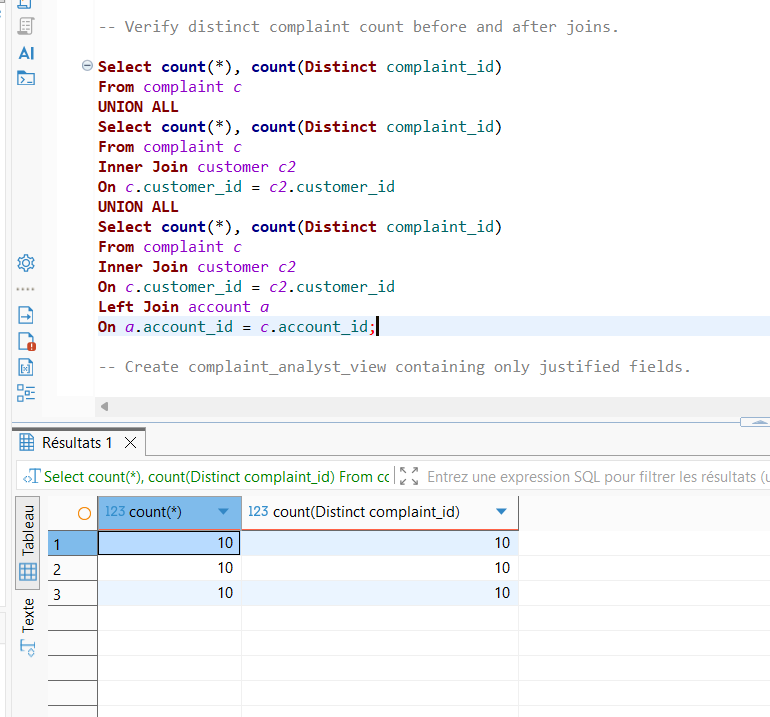

# Duplicate validation

Compare row counts before/after joins :

All tables created using JOIN queries contain 10 records. Since there are no missing values and each record has a unique match in the related table, both LEFT JOIN and INNER JOIN return the same number of records, without introducing duplicates or excluding any data.
