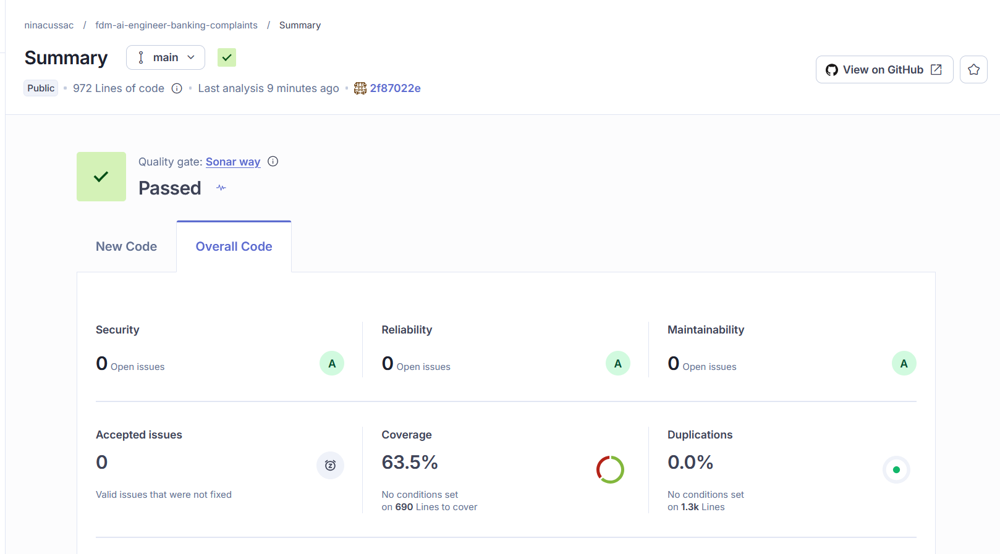
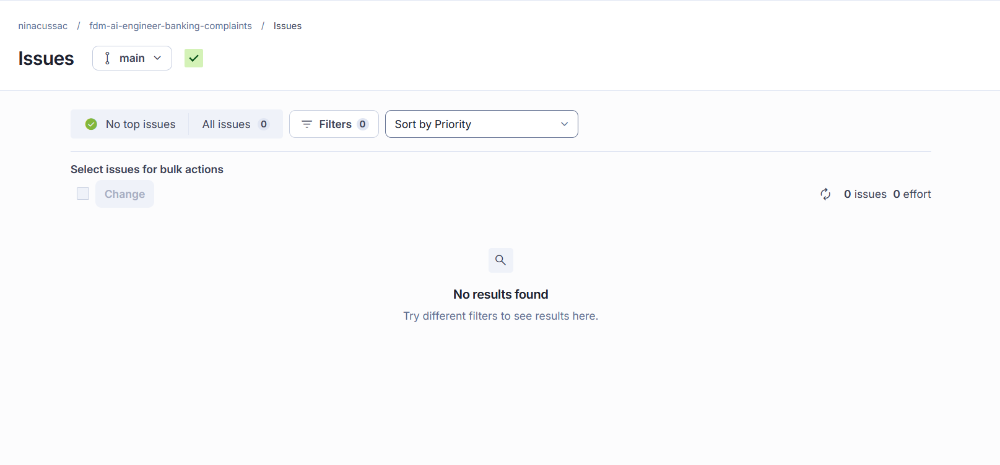

# SonarQube Security Review Report — Week 3

## 1. Objective

The objective of this review is to evaluate the security and code quality of the Banking Complaint Resolution Assistant using SonarQube Cloud.

The analysis is performed automatically through GitHub Actions on the `main` branch.

## 2. Tools and Configuration

- **Static analysis:** SonarQube Cloud
- **Version control:** GitHub
- **Continuous integration:** GitHub Actions
- **Language:** Python 3.12
- **Framework:** FastAPI
- **Database:** SQLite with SQLAlchemy
- **Testing:** pytest and pytest-cov

The analysis targets the application source code in `src/`, while test files are identified separately in `tests/`.

## 3. SonarQube Analysis Results

| Metric | Result |
|---|---|
| Quality Gate | Passed |
| Security rating | A |
| Security issues | 0 open |
| Reliability rating | A |
| Maintainability rating | A |
| Total issues | 0 |
| Accepted issues | 0 |
| Security Hotspots | 0 |
| Test coverage | 63.5% |
| Duplications | 0.0% |

The issue list was checked on the `main` branch with all filters cleared.

## 4. Test Evidence

GitHub Actions executes the unit and integration tests before running the SonarQube scanner.

The test command is:

```bash
python -m pytest tests/unit tests/integration --cov=src --cov-report=xml:coverage.xml
```

The test suite previously completed successfully with 42 passing tests.

The generated `coverage.xml` file is imported into SonarQube Cloud, producing a reported coverage of 63.5%.

## 5. Security Review Findings

### 5.1 Static Analysis

SonarQube Cloud reported no open security issues and no Security Hotspots in the analyzed source code.

The Security rating is A.

### 5.2 Authentication and Authorization

A previous manual code review identified that the complaint API endpoints did not visibly enforce authentication or role-based authorization.

This is a security gap relative to the project's specification, which requires complaint information to be accessible only to authorized users.

SonarQube did not report this issue. Static analysis alone cannot guarantee that access-control requirements are correctly implemented.

**Risk:** Unauthorized access to complaint records if the API is exposed without additional protection.

**Recommendation:** Implement and test authentication and authorization before using the application with real customer data or deploying it to an accessible environment.

**Status:** Open — Requires remediation or an approved scope decision.

### 5.3 Remaining Testing Limitations

Test coverage is 63.5%, meaning some executable code is not exercised by the selected automated test suites.

The current analysis does not establish complete security test coverage.

Additional tests should eventually cover authorization failures, access restrictions and other security-sensitive operations.

## 6. Conclusions

The SonarQube analysis completed successfully, with a passed Quality Gate and no reported issues.

The integration with GitHub Actions and pytest-cov also enables automated measurement of test coverage.

However, the absence of detected vulnerabilities does not demonstrate that the application is fully secure.

Authentication and authorization remain important requirements to address before production deployment.

## 7. Evidence

- SonarQube Cloud project: `ninacussac_fdm-ai-engineer-banking-complaints`
- Branch analyzed: `main`
- GitHub Actions workflow: `.github/workflows/sonarqube.yml`
- SonarQube configuration: `sonar-project.properties`
- Project specification: `spec.md`
- Automated test suites: `tests/unit/` and `tests/integration/`

## 8. Screenshots

### SonarQube Analysis Summary



### SonarQube Issues

