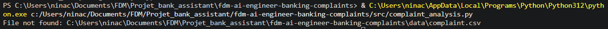
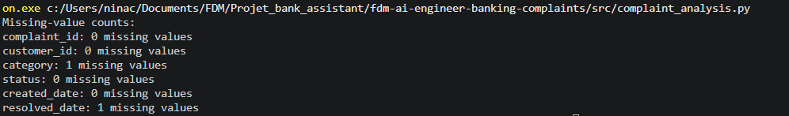
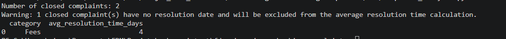

# Failure Test Results

## Test 1 : Missing CSV File

Verify that the script handles a missing input file gracefully.

The CSV file path was deliberately changed to point to a non-existent file.

Expected result: The script should display a clear error message and stop processing without an unhandled exception.

Actual result: The script displayed a File not found message identifying the missing file.

## Test 2 : Missing Required Columns

Verify that the script detects missing required columns.

The source CSV contains date_opened and date_closed, whereas the expected analysis schema requires created_date and resolved_date.

Expected result: The validation function should identify the required columns that are absent.

Actual result: The validation function raised the following exception:

The source CSV uses different column names for the same date fields. The script therefore normalizes the column names before validating the analysis schema.

## Test 3 : Incomplete row

Verify that the script correctly identifies missing values without unnecessarily interrupting execution.
A synthetic dataset was created with one missing category value and one missing resolved_date value.

Expected result: The validation function should report the missing values without raising an exception, since all required columns are present.

Actual result: The script successfully identified the missing values:

The script successfully detects incomplete records while allowing the analysis to continue.

## Test 4 : Missing resolution date

Verify that the script correctly handles closed complaints with missing resolution dates without affecting the accuracy of the average resolution time calculation.

Test Scenario: A synthetic dataset was created containing a complaint with a Closed status but no resolved_date.

Expected Result:
- The script should identify closed complaints with missing resolution dates.
- A clear warning message should be displayed.
- These complaints should be excluded from the average resolution time calculation.
- The complaints should still be included in the overall complaint counts.

Actual Result:
The script displayed the following warning:

The complaint was excluded from the resolution time calculation while remaining included in the total complaint count.

## Test 5 : Empty dataset

Verify that the script handles empty CSV files gracefully without attempting to perform calculations on unavailable data.

### Test Scenarios:

Two scenarios were tested:

Scenario A — Completely Empty File: A CSV file containing no data and no headers.

Scenario B — Headers Only: A CSV file containing the required column headers but no complaint records.

Expected Results:

For Scenario A, the script should display a clear error message indicating that the CSV file is empty.

For Scenario B, the script should display a warning indicating that no complaint records were found.

In both scenarios, the script should stop processing without raising an unhandled exception.

Actual Results:

Scenario A:

Error: The CSV file is empty.

Scenario B:

Warning: The CSV file contains no records.

In both scenarios, the script stopped processing without attempting to calculate complaint metrics.