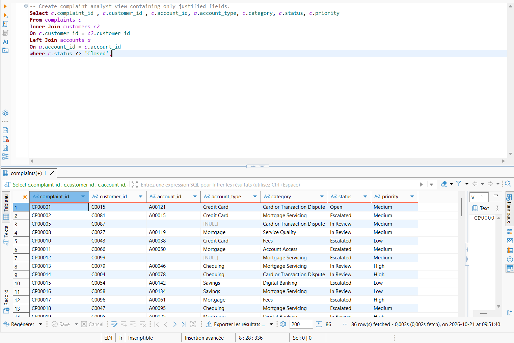

# Verify a complaint without account_id stays visible : 
With the previous data we have : 

Using data from the shared documents containing more than 10 records, we can confirm that the query works as expected, as complaints without an account_id are still included in the results.

