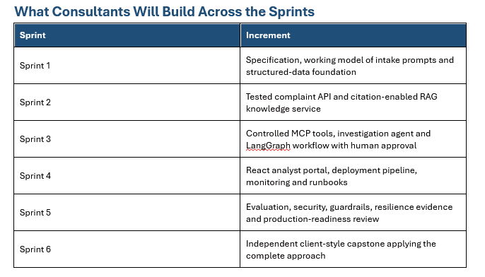

# Query exploration

## Tables and Counts

### Query : 

### Result :

There are 10 samples in each tables.

## Feature, Data_type, null constraint

### Query : 

### Account table : 

### Audit_log table :

### Complaint table : 

### Complaint_status_history table :

### Customer table :

### Customer_response table : 

### Employee table : 

### Fee table :

### Investigation table : 

### Policy_document table :

### Policy_section table : 

### Recommendation table :

### Review_decision table : 

### Review_request table :

### Service_request table : 

### Transactions table :

## Observation :

- In the complaint_status_history table, all status changes have identical timestamps. This is unrealistic for a banking environment, where complaints are typically processed and updated at different times.

- A similar issue appears in the audit_log table, where all event_timestamp values are recorded within the same second.

- In the fee table, several records have a NULL value in the transaction_id column.

However, this does not necessarily indicate a data quality issue. Some fees, such as account maintenance fees, are applied directly to a customer's account without being linked to a specific transaction.
The database schema explicitly allows transaction_id to be NULL, making this behavior consistent with the current data model.

- The database contains a relatively small number of records, with only 10 customers, 10 accounts, and 10 complaints. It is not representative of a real banking environment.